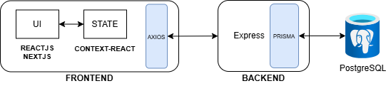
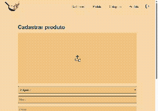
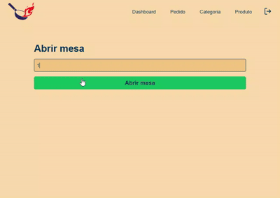
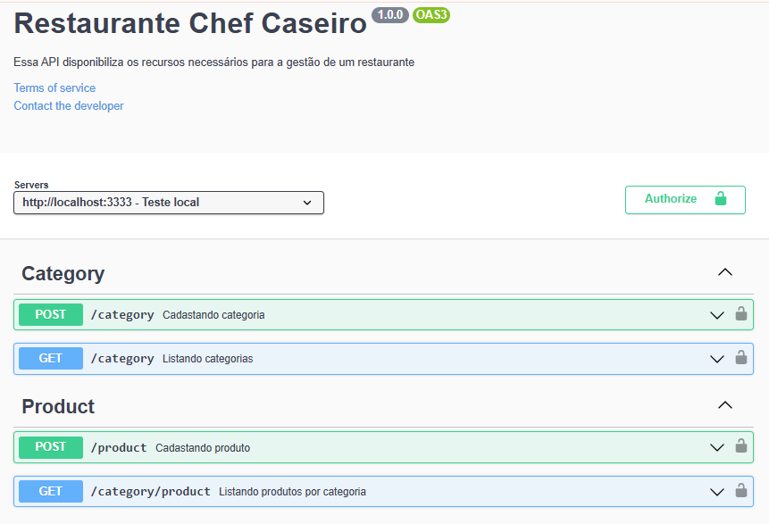

# 🍳 Chef Caseiro

Projeto de estudo desenvolvido com o objetivo de praticar conceitos de desenvolvimento **Fullstack**, explorando a integração ponta a ponta entre **Next.js** (Frontend), **Node.js / Express + Prisma ORM** (Backend/API) e **PostgreSQL** (Banco de Dados).

> **Nota sobre o escopo:** Como o foco principal deste repositório é consolidar a arquitetura de comunicação entre camadas, persistência de dados e documentação de API, não foram priorizadas validações avançadas de formulário (como regras de preço), suítes de testes automatizados ou refinamentos visuais de UI.

---

## 🏗️ Arquitetura do Projeto

O fluxo de dados da aplicação segue uma arquitetura desacoplada entre cliente, servidor e banco de dados relacional:



* **Frontend (`Next.js` + `React.js`):** Gerenciamento de estado global com `Context API` (`context-react`) e comunicação HTTP com a API realizada via `Axios`.
* **Backend (`Node.js` + `Express`):** API REST responsável pelas regras de negócio, autenticação e comunicação com o banco de dados através do `Prisma ORM`.
* **Banco de Dados (`PostgreSQL`):** Armazenamento relacional estruturado via migrations do Prisma.

---

## 🚀 Tecnologias Utilizadas

* **Frontend:** React.js, Next.js, TypeScript, Context API, Axios
* **Backend:** Node.js, Express, Prisma ORM, Swagger (OpenAPI 3.0)
* **Banco de Dados:** PostgreSQL

---

## 📸 Evidências de Funcionamento

### 1. Cadastro de Produto
Fluxo de seleção de categoria, preenchimento dos dados do item e envio de imagem integrado à API:



### 2. Abertura de Mesa e Criação de Pedido
Fluxo operacional de abertura de mesa e vinculação de itens ao pedido em tempo real:



### 3. Documentação da API (Swagger)
Endpoints documentados em OpenAPI 3.0 para gerenciamento de categorias (`POST /category`, `GET /category`), produtos (`POST /product`, `GET /category/product`), pedidos e autenticação:



---

## ⚙️ Como Executar o Projeto Localmente

### Pré-requisitos
* [Node.js](https://nodejs.org/) instalado
* [PostgreSQL](https://www.postgresql.org/) rodando localmente (ou via Docker)

### 1. Clonar o repositório
```bash
git clone [https://github.com/seu-usuario/chef-caseiro.git](https://github.com/seu-usuario/chef-caseiro.git)
cd chef-caseiro